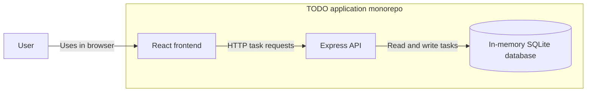
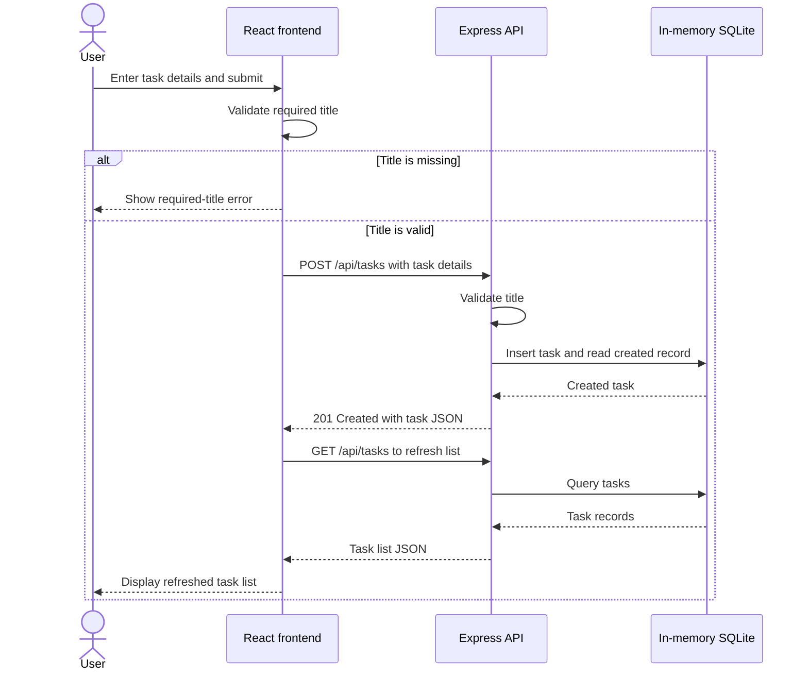

# Architecture Overview

This diagram describes the current monorepo implementation, not a proposed cloud deployment.
The React frontend communicates with the Express API, which stores tasks in an in-memory SQLite
database. Data is lost when the backend process restarts.

## System Context

## Create a TODO

